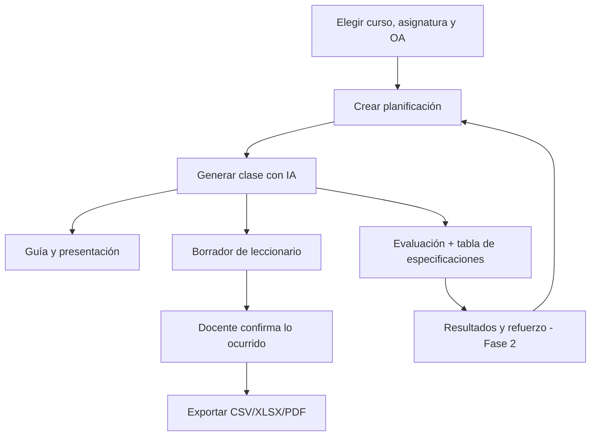

# PRD — Plataforma de trabajo pedagógico con IA (LetItFlow, nombre provisional)

Estado: borrador de Fase 0. Fecha: 2026-10-21.

## 1. Propósito

Una plataforma web para que los docentes gestionen su ciclo de trabajo desde un solo lugar y reutilicen lo que ya hicieron: planificar, preparar material, evaluar, registrar el leccionario y, más adelante, gestionar cursos, asistencia y comunicación con apoderados.

Principio diferenciador: **las herramientas comparten información**. Una planificación de clase alimenta la guía, la presentación, la evaluación y el borrador del leccionario sin volver a ingresar los mismos datos.

La IA es un apoyo al criterio profesional del docente. No diagnostica estudiantes, no decide objetivos curriculares y no registra por sí sola lo que ocurrió en una clase.

## 2. Usuarios y modelo de acceso

| Usuario | Qué necesita |
|---|---|
| Docente individual | Su propio espacio, privado por defecto. |
| Equipo de docentes | Compartir recursos de forma voluntaria dentro de un espacio. |
| Establecimiento | Espacios institucionales (fase posterior). |
| Administrador de la plataforma | Operación y soporte, sin acceso a contenido privado salvo autorización. |

Roles dentro de un espacio de trabajo: `owner`, `admin`, `editor`, `viewer`.

Los datos de un docente o establecimiento nunca quedan expuestos a otros por defecto. El modelo comercial (gratuito, freemium, suscripción o licencia institucional) **no está definido**; la arquitectura lo permite pero no se implementan pagos.

## 3. Alcance de esta etapa

Dentro de alcance:
- Fase 0: documentación e investigación.
- Esqueleto de la aplicación: autenticación, espacios de trabajo, base de datos con RLS, capa de IA, navegación y pruebas.
- Foco curricular del MVP: **1° básico, todas las asignaturas**.

Fuera de alcance, por decisión del titular del proyecto:
- **Integración con Alexia.** Se desarrollará en un proyecto aparte. Este producto solo ofrece exportación genérica del leccionario (CSV/XLSX/PDF).
- Pagos y decisiones comerciales.
- Despliegue en establecimientos con datos reales de estudiantes.

## 4. Matriz de funcionalidades y prioridades

Prioridad: P0 = MVP, P1 = siguiente, P2 = después, P3 = por validar.

| Módulo | Función clave | Prioridad | Fase |
|---|---|---|---|
| A. Currículum y planificación | OA e indicadores oficiales importados y versionados; planificación por unidad y clase | P0 | 1 |
| B. Generador de material | Guía imprimible, presentación descargable, actividades de inicio, desarrollo y cierre | P0 | 1 |
| C. Mejora de materiales | Subir un archivo, analizarlo y crear una versión mejorada sin tocar el original | P1 | 1–2 |
| D. Evaluaciones | Ítems clasificados, tabla de especificaciones validada con código, exportación | P0 | 1 |
| E. Inclusión y adecuaciones | Versiones con distinto apoyo, distinguiendo adecuación de acceso, metodológica y de objetivos | P1 | 2 |
| F. Corrección asistida | OCR, comparación con pauta, revisión humana de baja confianza | P2 | 2 |
| G. Cursos y estudiantes | Listas de curso, registros y observaciones con acceso restringido | P1 | 2–3 |
| H. Apoderados | Borradores de comunicación basados en hechos validados | P2 | 3 |
| I. Asistencia | Registro por curso y fecha, exportación CSV/XLSX | P1 | 3 |
| J. Leccionario | Borrador desde la planificación, confirmación por el docente, versiones, exportación genérica | **P0 (prioritario)** | 1 |
| K. Integración con Alexia | **Fuera de este proyecto** | — | — |
| L. Google Workspace | Drive, Slides y Classroom con OAuth y permisos mínimos | P2 | 4 |
| M. Pizarra interactiva | Reloj, temporizador, agenda visual, selector aleatorio; sin dependencias externas | P2 | 3 |
| N. Biblioteca colaborativa | Recursos personales primero; compartir y moderar después | P0 (personal) / P3 (pública) | 1 / 5 |
| O. Asistente contextual | Chat con herramientas internas de permisos acotados | P2 | 2–3 |

Funciones transversales (se incorporan solo si aportan valor): banco de preguntas, versiones equivalentes de una evaluación, analítica por OA, historial de cambios, auditoría, panel de costos de IA.

## 5. MVP (Fase 1)

Flujo mínimo que entrega valor real a un docente de 1° básico:

1. Registrarse con correo o Google. Se crea un espacio personal.
2. Crear un curso y sus asignaturas.
3. Elegir OA oficiales de 1° básico.
4. Crear una planificación (unidad y clase).
5. Generar la clase con IA y editarla.
6. Generar una guía imprimible y una presentación descargable.
7. Generar una evaluación con tabla de especificaciones y exportarla.
8. Guardar todo en la biblioteca personal.
9. Generar el borrador de leccionario, confirmarlo y exportarlo.

Las funciones se construyen como cortes verticales completos (interfaz, lógica, persistencia, permisos y pruebas), no como pantallas aisladas.

## 6. Criterios de aceptación del MVP

Cada criterio debe poder comprobarse con una prueba automatizada o una verificación manual documentada.

**Datos y permisos**
- CA-1. Un usuario no puede leer ni escribir datos de un espacio al que no pertenece. Hay pruebas SQL que lo demuestran.
- CA-2. Los roles limitan la escritura: `viewer` solo lee, `editor` crea y edita, `admin` y `owner` administran.
- CA-3. Toda operación relevante deja un registro en `audit_log`, sin datos personales de estudiantes.

**Currículum**
- CA-4. El generador solo usa OA presentes en la base importada. Si falta el OA, lo informa en vez de inventarlo.
- CA-5. Cada OA indica su fuente, versión y hash del documento de origen. Lo sugerido por IA queda rotulado como tal.

**Generación con IA**
- CA-6. Toda salida de la IA se valida contra un esquema; lo que no valida se rechaza y se informa.
- CA-7. Al proveedor de IA nunca se le envían nombres ni datos identificables de estudiantes.
- CA-8. Cada llamada registra tokens, costo estimado y tarea; existe un tope mensual por espacio.
- CA-9. Para 1° básico, las instrucciones son breves, la tipografía es grande y hay apoyo visual. Reglas medibles: largo máximo de instrucción, tamaño mínimo de fuente y una sola consigna por paso.

**Evaluaciones**
- CA-10. La tabla de especificaciones se deriva de los ítems y se valida con código: la suma de puntajes coincide con el total, las ponderaciones suman 100 % y cada ítem tiene OA, indicador y clave de respuesta.
- CA-11. El docente ve una vista previa editable antes de exportar.

**Leccionario**
- CA-12. El borrador se arma desde la planificación, pero solo el docente confirma lo que realmente ocurrió.
- CA-13. No pueden existir dos registros para el mismo curso, asignatura, fecha y bloque. Cada edición crea una versión.
- CA-14. La exportación incluye fecha, curso, asignatura, OA, objetivo, contenidos, actividades, recursos, evidencia y observaciones.

**Experiencia y calidad**
- CA-15. Hay estados de carga y de error claros; la interfaz funciona en computador, tablet y celular.
- CA-16. Navegación por teclado y contraste suficiente (WCAG 2.1 AA como meta).
- CA-17. Ninguna función que no esté implementada se presenta como funcional; aparece como «Próximamente».
- CA-18. Lint, tipos, pruebas y build pasan sin errores.

## 7. Mapa de navegación

1. Inicio (accesos rápidos: crear una clase, preparar una evaluación, mejorar un archivo, completar el leccionario)
2. Planificación
3. Crear material
4. Evaluaciones
5. Adecuaciones
6. Mis cursos
7. Pizarra interactiva
8. Leccionario
9. Asistencia
10. Apoderados
11. Biblioteca de recursos
12. Configuración e integraciones

En el esqueleto, solo Inicio y las páginas de acceso son funcionales. El resto muestra «Próximamente».

## 8. Flujo principal

## 9. Principios de producto

- Privacidad primero: los datos de menores no se usan para desarrollo ni pruebas; solo datos sintéticos.
- La IA propone, el docente decide y valida.
- Distinguir siempre lo oficial de lo sugerido, y lo planificado de lo realizado.
- No sobrescribir archivos originales.
- Simplicidad: pocas acciones por tarea, formularios breves, guardado automático donde corresponda.

## 10. Preguntas abiertas

- Nombre definitivo del producto y modelo comercial.
- Fuente estructurada de OA e indicadores de 1° básico (ver `TECHNICAL_DESIGN.md`).
- Revisión legal bajo la Ley 21.719 antes de cualquier piloto con datos reales.
