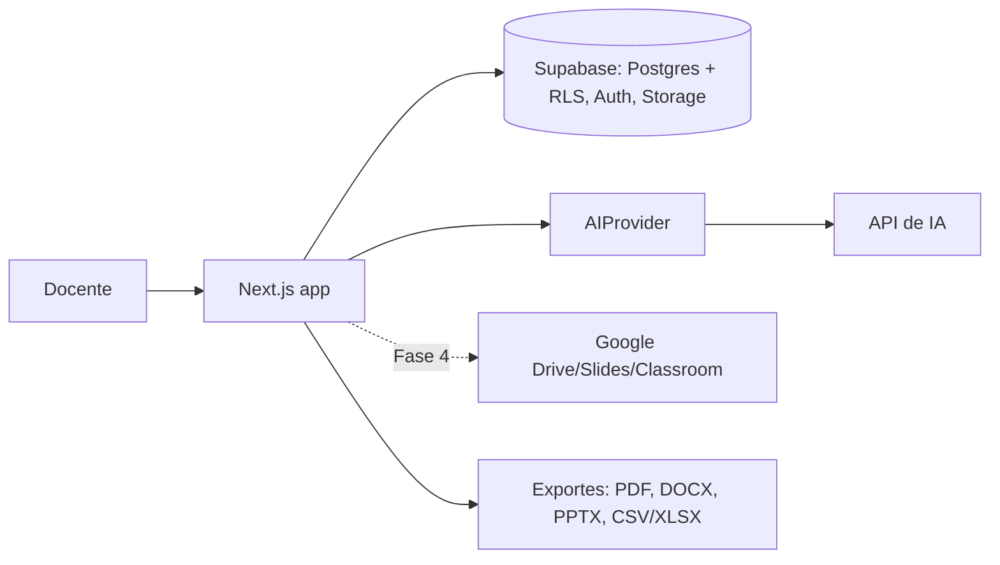
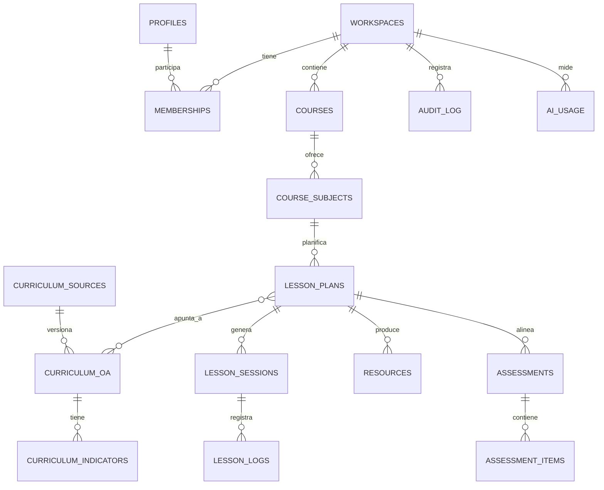

# Diseño técnico

Estado: borrador de Fase 0. Fecha: 2026-10-21.

## 1. Principios

- Un solo monolito Next.js. Sin microservicios, colas ni Redis en el MVP.
- Seguridad y privacidad desde el esqueleto, no como mejora posterior.
- Las integraciones externas son módulos independientes que se pueden apagar.
- Solo se construye lo que aporta valor en el MVP; el resto queda documentado.

## 2. Arquitectura

| Capa | Decisión |
|---|---|
| App | Next.js 16 (App Router) + React + TypeScript, gestionado con pnpm |
| UI | Tailwind CSS + componentes accesibles basados en Radix (estilo shadcn/ui) |
| Datos | Supabase: Postgres, Auth y Storage |
| Migraciones | SQL versionado en `supabase/migrations` |
| Validación | zod en formularios, rutas de API y salidas de IA |
| IA | Interfaz `AIProvider` con adaptador de Claude y proveedor falso para pruebas |
| Exportación | PDF (impresión HTML), DOCX, PPTX y CSV/XLSX |
| Integraciones | `src/integrations/google` (Fase 4) |
| Pruebas | Vitest, pruebas SQL de RLS contra Postgres 16, Playwright |



Por qué Supabase: RLS nativa para aislar datos de menores, OAuth con Google incluido y SQL estándar, por lo que se puede migrar a otro Postgres. No se usa un ORM: Prisma está en versión candidata y complica la RLS.

## 3. Multi-tenencia y permisos

- Cada docente recibe un **espacio personal** al registrarse (trigger en `auth.users`).
- Toda tabla de dominio lleva `workspace_id`.
- El acceso pasa por funciones `security definer`:
  - `public.is_member(ws uuid)`: el usuario pertenece al espacio.
  - `public.has_role(ws uuid, min_role)`: el usuario tiene al menos ese rol.
- Orden de roles: `viewer` < `editor` < `admin` < `owner`.
- La clave de servicio solo se usa en el servidor y nunca llega al cliente.
- Por defecto nada se comparte entre espacios. Compartir será una acción explícita (Fase 5).

## 4. Modelo de datos

Se implementa por capas.

**Capa 0 (esqueleto):** `profiles`, `workspaces`, `memberships`, `audit_log`, `ai_usage`, `courses`.

**Capa 1 (MVP):** `subjects`, `course_subjects`, `curriculum_sources`, `curriculum_oa`, `curriculum_indicators`, `units`, `lesson_plans`, `lesson_sessions`, `resources`, `resource_versions`, `assessments`, `assessment_items`, `lesson_logs`, `lesson_log_versions`, `export_jobs`.

**Capa 2:** `students`, `enrollments`, `accommodations`, `submissions`, `scans`, `grades`, `feedback`, `attendance`, `communications`.

**Capa 3:** `external_accounts` (tokens cifrados), `shares`, `library_items`, `collections`, `ratings`.



Reglas del modelo:
- **Origen del contenido.** OA, indicadores y textos llevan `origin` (`official`, `teacher`, `ai_suggested`) y `status` (`draft`, `validated`).
- **Leccionario.** Cada sesión tiene un borrador sugerido, un registro confirmado por el docente y versiones. Restricción única por curso, asignatura, fecha y bloque. Los campos de exportación se definen en un perfil genérico y versionado.
- **Evaluaciones.** La tabla de especificaciones se **deriva** de los ítems; no es un documento aparte.
- **Archivos.** Los originales nunca se sobrescriben; las versiones mejoradas son archivos nuevos con referencia al original.

## 5. Currículum nacional

- Fuente oficial: Bases Curriculares y Programas de Estudio del Mineduc, publicados en curriculumnacional.cl.
- En la investigación inicial **no se encontró** una API ni una descarga abierta de OA e indicadores. Solo hay documentos PDF. Esto debe confirmarse contra la fuente primaria.
- Plan de importación: un proceso que extrae OA e indicadores desde el documento oficial, guarda la fuente (URL, versión, hash del archivo, fecha) y exige **revisión humana** antes de marcar el contenido como `validated`.
- Los OA nunca se inventan. Si un OA no está en la base, el generador lo informa.

## 6. Capa de IA

```ts
interface AIProvider {
  generate<T>(req: {
    task: string;            // p. ej. "lesson.generate"
    system: string;
    input: string;
    schema: ZodType<T>;      // la salida debe validar
    workspaceId: string;
  }): Promise<{ data: T; usage: AIUsage }>;
}
```

- El adaptador de Claude es el predeterminado; se puede cambiar el proveedor sin tocar los módulos.
- Cada llamada registra tokens, costo estimado, tarea y espacio en `ai_usage`.
- Tope mensual por espacio y límite de solicitudes por usuario, sin infraestructura adicional (contadores en Postgres).
- **Minimización de datos:** nunca se envían nombres ni identificadores de estudiantes. Se usan seudónimos o se omiten.
- **Contenido no confiable:** los documentos subidos se delimitan como datos y no pueden activar herramientas ni acciones.
- Los modelos usados se configuran por tarea mediante variables de entorno, no en el código.

Políticas del proveedor (a verificar contra la documentación oficial antes de enviar datos reales): según la documentación de Anthropic, el contenido de la API no se retiene por defecto salvo en modelos que exigen retención de 30 días, y lo retenido no se usa para entrenar sin permiso. La retención cero requiere aprobación.

## 7. Seguridad y privacidad

- RLS en todas las tablas; pruebas SQL de aislamiento obligatorias.
- `audit_log` solo admite inserciones y no almacena datos personales de estudiantes.
- Los logs enmascaran datos personales.
- Archivos en almacenamiento privado con URL firmadas; validación de tipo, tamaño y firma del archivo.
- Cabeceras de seguridad y CSP.
- Sesiones gestionadas por Supabase Auth; sin tokens en `localStorage` propio.
- Secretos solo en variables de entorno; `.env.example` sin valores reales.
- Sin datos reales de estudiantes en desarrollo, depuración ni pruebas.
- Ley 21.719: vigente desde el 1-dic-2026 salvo que se apruebe su postergación (proyecto en el Senado). Para menores de 16 se exige consentimiento de los representantes salvo que una ley lo autorice. Se requiere revisión legal antes de cualquier piloto.

## 8. Integración con Google (Fase 4)

Ver `research/google-workspace.md`. Se piden scopes mínimos y de forma incremental. No se simulan integraciones con enlaces.

## 9. Sistema visual

- Interfaz cálida, limpia y adaptable (computador, tablet y celular).
- Tokens de diseño en variables CSS; modo claro y oscuro.
- Tipografía legible; en material para 1° básico, tamaños grandes y poco texto.
- Componentes reutilizables: botones, formularios, tarjetas, estados vacíos, diálogos de confirmación y estados de carga y error.
- Contraste mínimo WCAG 2.1 AA y navegación completa por teclado.

## 10. Pruebas

| Tipo | Herramienta | Qué cubre |
|---|---|---|
| Unitarias | Vitest | Validaciones, utilidades, capa de IA con proveedor falso |
| Base de datos | SQL contra Postgres 16 local con esquema `auth` simulado | RLS, roles, aislamiento entre espacios |
| Humo end-to-end | Playwright | Páginas de acceso y navegación |
| Estáticas | ESLint, TypeScript, Prettier | Calidad de código |

Limitación conocida: sin Docker no hay Supabase local, por lo que el inicio de sesión real contra Supabase y Google solo se prueba cuando existan credenciales de un proyecto Supabase.

## 11. Mantenimiento

- Dependencias actualizadas mensualmente con revisión de cambios incompatibles.
- Migraciones solo hacia adelante, siempre con prueba de RLS.
- Registro de decisiones en `DECISIONS.md` y de riesgos en `RISKS.md`.
